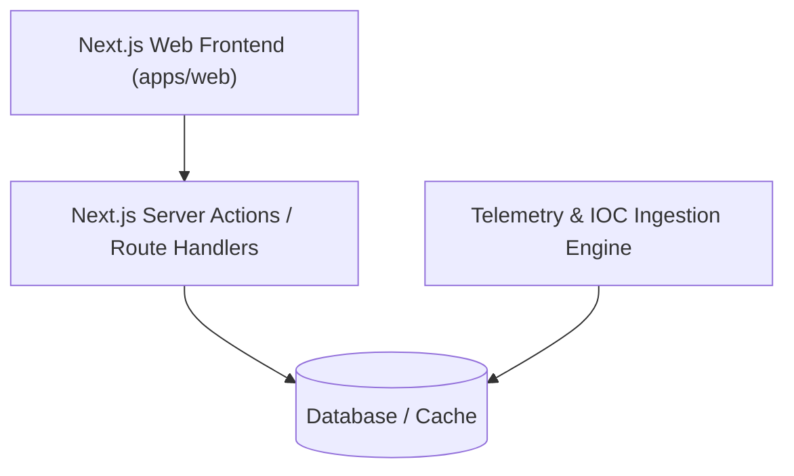

# CyberTrace - Architecture

## System Overview
CyberTrace is structured as a monorepo containing web applications, services, and shared libraries.

## Components
- **apps/web**: Next.js (App Router) modern web application styled with Tailwind CSS.
- **Data Layer**: Relational/Document storage for telemetry logs and graph associations.
- **Analysis Pipeline**: Pattern matching and correlation algorithms for threat tracing.
